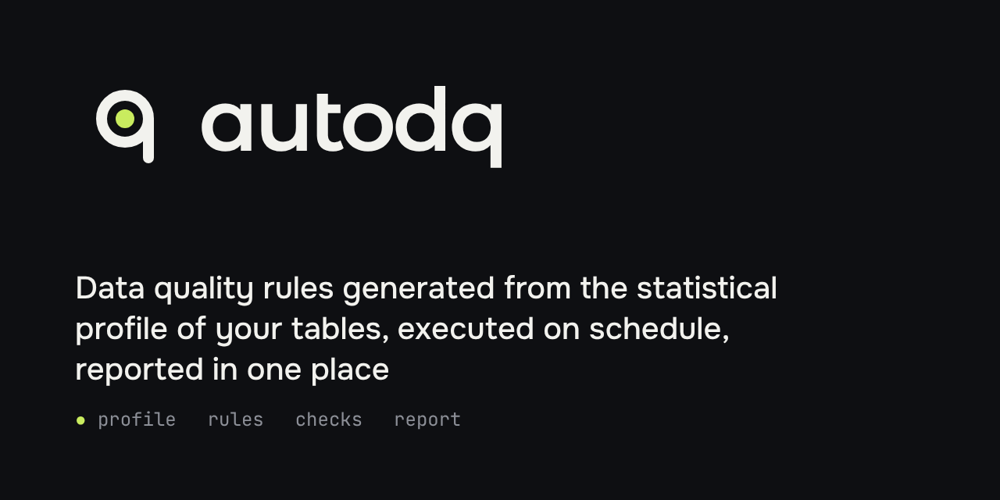
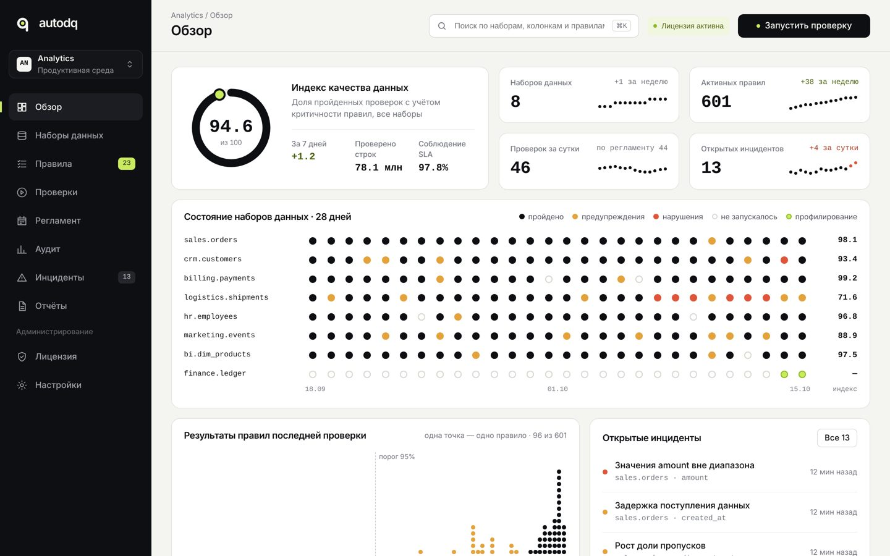
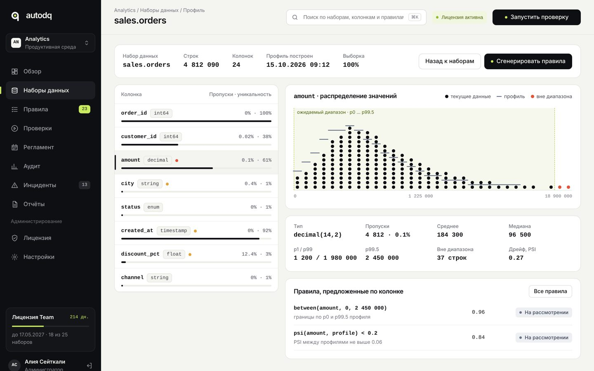
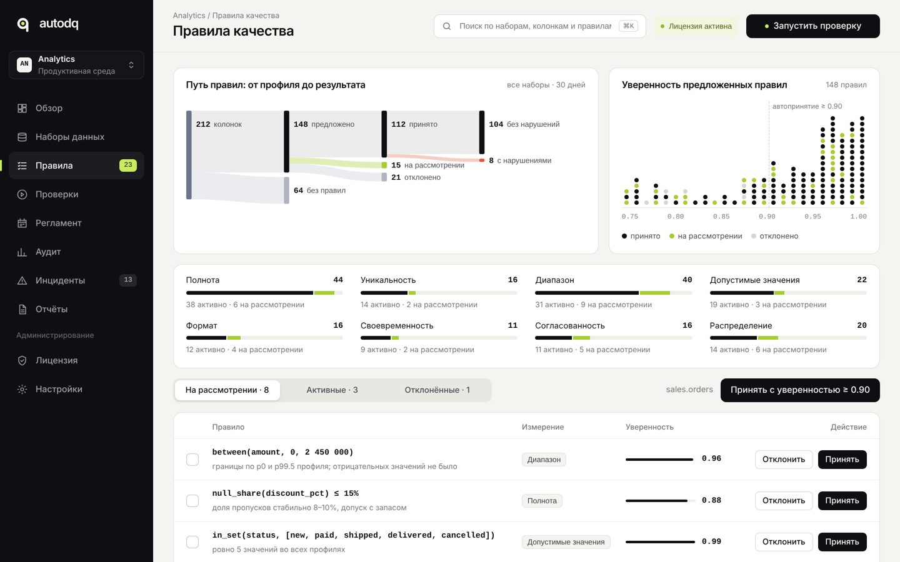
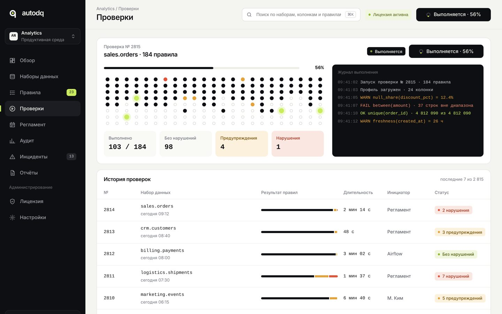
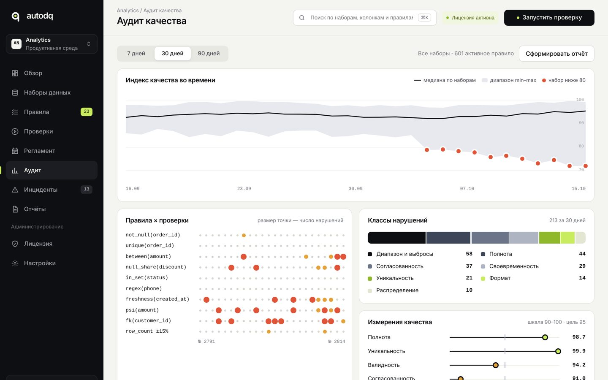
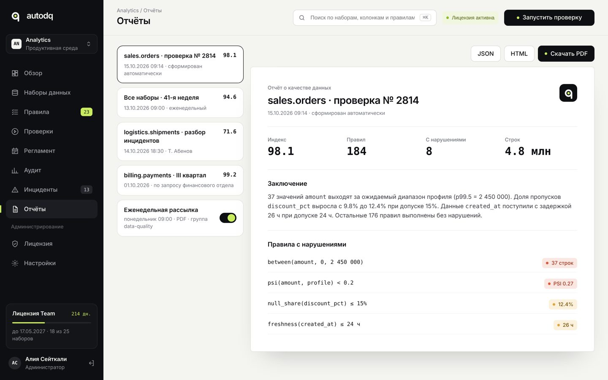

<p align="center">
  
</p>

<p align="center">
  <b>Автоматическая генерация и выполнение правил контроля качества данных на основе их статистического профиля</b>
</p>

<p align="center">
  <a href="#как-это-работает">Как это работает</a> ·
  <a href="#модули">Модули</a> ·
  <a href="#интерфейс">Интерфейс</a> ·
  <a href="#структура-репозитория">Структура</a> ·
  <a href="#статус">Статус</a>
</p>

---

## О проекте

autodq — прототип инструмента Data Quality для табличных наборов данных. Система строит статистический профиль набора, по профилю предлагает правила контроля качества, выполняет их по регламенту, фиксирует результаты, классифицирует отклонения и формирует отчёт.

Пользователь не пишет правила с нуля: он проверяет и подтверждает то, что предложила система, и при необходимости меняет пороги.

## Как это работает

```
 источник данных ──▶ профиль ──▶ правила ──▶ проверки ──▶ отчёт
                      │            │            │           │
            типы, пропуски,   предложены    выполнены    индекс,
            уникальность,     с оценкой     по регламенту нарушения,
            распределения,    уверенности,  результаты   классы
            диапазоны,        подтверждены  сохранены    проблем
            частоты           пользователем
```

1. **Профилирование.** Для каждой колонки считаются тип, доля пропусков, уникальность, распределение, квантили, диапазон, частоты значений.
2. **Генерация правил.** По профилю формируются правила (`not_null`, `unique`, `between`, `in_set`, `regex`, `freshness`, `psi` и др.) с оценкой уверенности и основанием.
3. **Подтверждение.** Пользователь принимает, отклоняет или настраивает предложенные правила.
4. **Выполнение.** Правила запускаются вручную или по регламенту, результаты фиксируются по каждому правилу.
5. **Отчёт.** Индекс качества, отклонения от профиля, классификация проблем: полнота, уникальность, диапазон, формат, согласованность, своевременность, распределение.

## Модули

| Модуль | Что делает | Статус |
|---|---|---|
| `profiling` | Статистический профиль набора данных | в работе |
| `rules` | Генерация правил по профилю, оценка уверенности | в работе |
| `checks` | Выполнение правил, хранение результатов, регламент | в работе |
| `report` | Отчёт о качестве данных (HTML, PDF, JSON) | запланировано |
| `ui` | Веб-интерфейс по макетам из `design/` | макеты готовы |

## Интерфейс

<table>
  <tr>
    <td width="50%"><br><sub>Обзор: индекс качества, состояние наборов, результаты правил</sub></td>
    <td width="50%"><br><sub>Профиль набора: распределение колонки, ожидаемый диапазон, выбросы</sub></td>
  </tr>
  <tr>
    <td><br><sub>Правила: путь от профиля до результата, подтверждение</sub></td>
    <td><br><sub>Проверка: выполнение 184 правил в реальном времени</sub></td>
  </tr>
  <tr>
    <td><br><sub>Аудит: динамика индекса, правила × проверки, классы нарушений</sub></td>
    <td><br><sub>Отчёт о качестве данных</sub></td>
  </tr>
</table>

Все экраны: [`design/screens/`](design/screens) (открываются в браузере) и [`design/export/png/`](design/export/png).

## Структура репозитория

```
autodq/
├── design/
│   ├── screens/        статичные HTML-версии экранов, открываются в браузере
│   ├── source/         исходники интерактивного прототипа
│   ├── export/
│   │   ├── png/        все экраны в PNG @2x
│   │   └── figma/      основные экраны в SVG и PDF для импорта в Figma
│   └── brand/          логотип, аватар, превью репозитория
├── docs/
│   ├── reports/        отчёты по неделям курса
│   └── assets/         изображения для README
└── src/                код (добавляется)
```

## Бренд

| | |
|---|---|
| Цвета | `#0E0F12` ink · `#F2F2EE` paper · `#C9EC5F` lime |
| Шрифты | Onest — интерфейс, JetBrains Mono — данные, Montserrat Alternates — логотип |
| Знак | кольцо из четырёх шагов (профиль, правила, проверка, отчёт) с хвостом — буква q, точка в центре — проверенные данные. Всегда на чёрной подложке |

## Статус

Прототип интерфейса готов, идёт разработка модулей профилирования и генерации правил. Задачи и прогресс — во вкладке [Issues](../../issues) и на доске [Projects](../../projects).

## Команда

| Участник | Зона ответственности |
|---|---|
| [@имя](https://github.com/) | интерфейс, дизайн, отчёт |
| [@имя](https://github.com/) | профилирование, выполнение правил |

---

<sub>Все права защищены. Код не распространяется под открытой лицензией.</sub>
