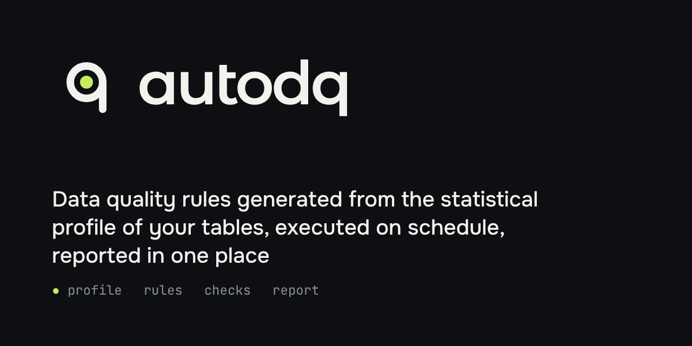
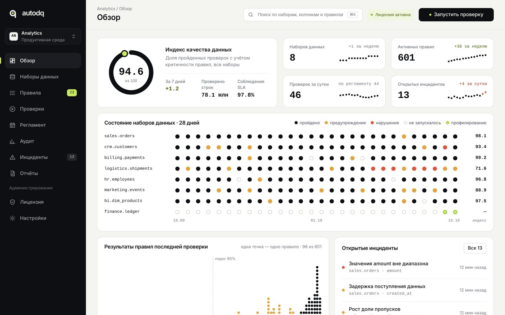
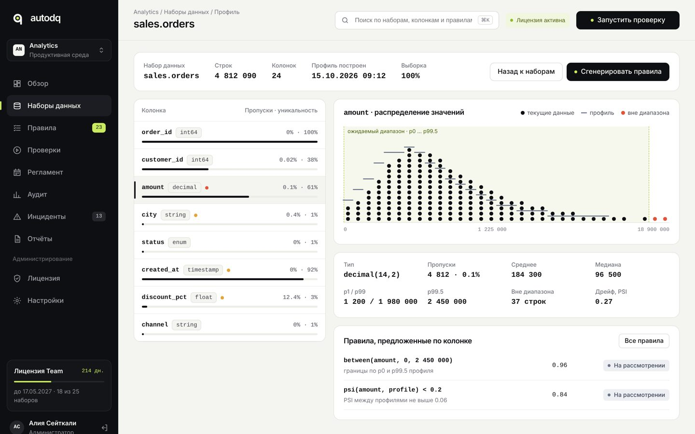
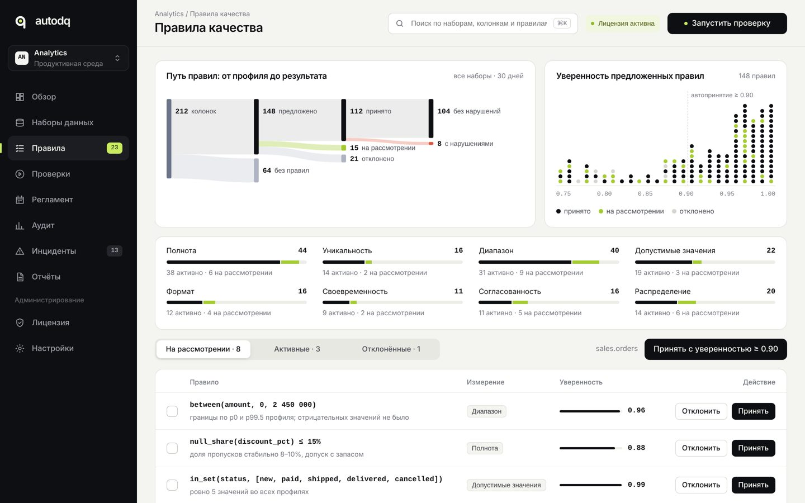
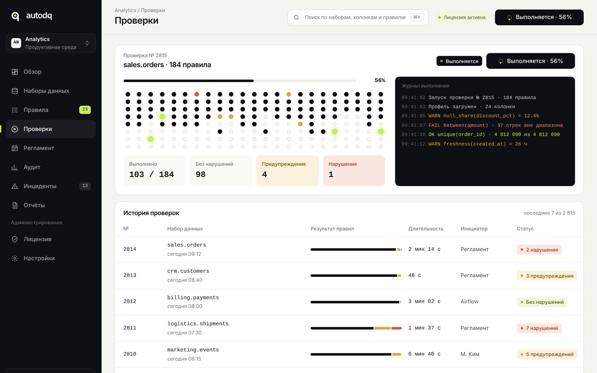
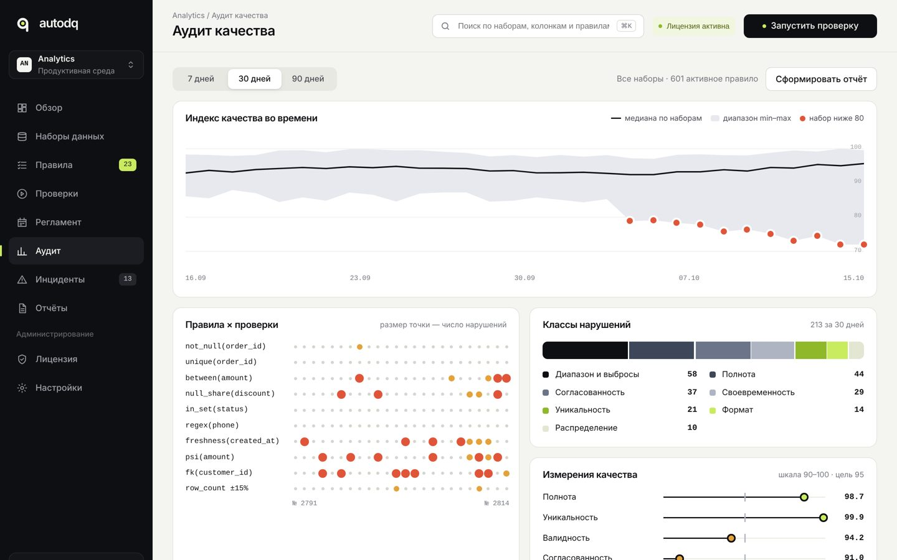
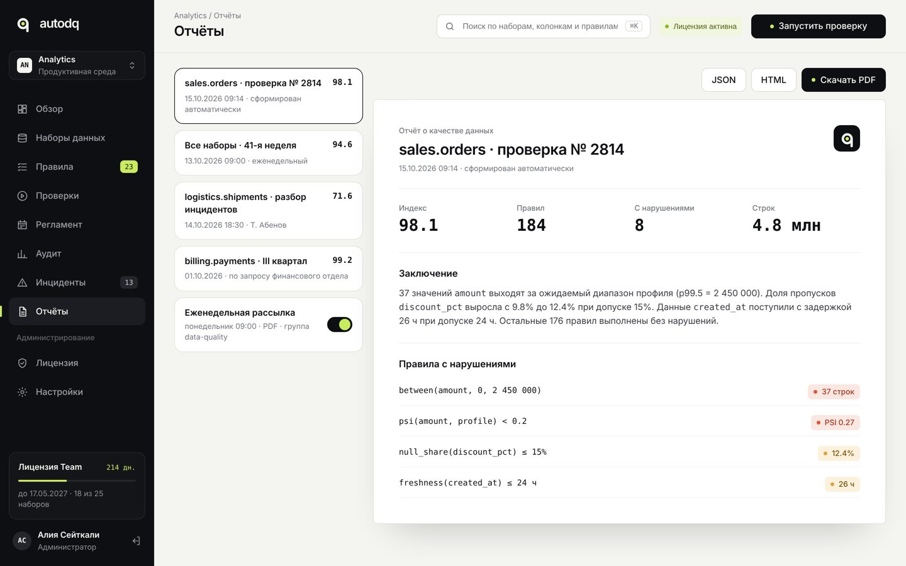

<p align="center">
  
</p>

<p align="center">
  <b>Автоматическая генерация и выполнение правил контроля качества данных на основе их статистического профиля</b>
</p>

<p align="center">
  <a href="#как-это-работает">Как это работает</a> ·
  <a href="#модули">Модули</a> ·
  <a href="#интерфейс">Интерфейс</a> ·
  <a href="#структура-репозитория">Структура</a> ·
  <a href="#статус">Статус</a>
</p>

---

## О проекте

autodq — приложение для контроля качества табличных данных. Статистическое ядро строит профиль эталонного CSV, предлагает правила, выполняет подтверждённые правила на новом срезе и формирует отчёт. Браузерный интерфейс показывает демоданные и открывает JSON-отчёты локального анализа.

Пользователь проверяет предложенные правила и выбирает, какие из них применять к новым срезам.

## Локальный запуск

Выполните команды в корне проекта с Node.js 22.12+.

~~~sh
npm ci
npm run dev
~~~

Откройте [http://localhost:5173](http://localhost:5173). Команда `npm run build` создаёт статическую сборку в `dist/`, а `npm run preview` запускает её предпросмотр.

Для анализа CSV установите ядро в виртуальное окружение с Python 3.11+ и запустите пример.

~~~sh
python -m pip install -e .
python examples/generate_snapshots.py
autodq profile autodq-runs/reference.csv -o autodq-runs/profile.json
autodq fit autodq-runs/reference.csv -o autodq-runs/suggested.json
autodq review autodq-runs/suggested.json --approve-all -o autodq-runs/approved.json
autodq check autodq-runs/stable.csv --rules autodq-runs/approved.json -o autodq-runs/stable.json
autodq check autodq-runs/shifted.csv --rules autodq-runs/approved.json -o autodq-runs/shifted.json --html autodq-runs/shifted.html
~~~

В примере намеренно внесены пропуски, дубликаты, новые категории и сдвиг числового распределения. Проверка `shifted.csv` возвращает код 2 и сохраняет оба отчёта. Чтобы открыть её результат в приложении, выберите **Отчёты → Отчёт локального анализа** и загрузите `shifted.json`. Браузер читает файл локально.

Для своих данных передайте два независимых снимка с сопоставимым составом строк. Просмотрите `suggested.json` и одобрите подходящие правила параметром `--approve RULE_ID`. Параметр можно указать несколько раз. Подробности об объектах Python, статистике и результатах описаны в [документации ядра](docs/engine.md).

## Как это работает

```
 источник данных ──▶ профиль ──▶ правила ──▶ проверки ──▶ отчёт
                      │            │            │           │
            типы, пропуски,   предложены    выполнены    индекс,
            уникальность,     с оценкой     на новом срезе нарушения,
            распределения,    уверенности,  результаты   классы
            диапазоны,        подтверждены  сохранены    проблем
            частоты           пользователем
```

1. **Профилирование.** Для каждой колонки считаются тип, доля пропусков, уникальность, распределение, квантили, диапазон, частоты значений.
2. **Генерация правил.** Ядро предлагает проверки полноты, типа, диапазона, категорий, уникальности ключей и дрейфа распределений.
3. **Подтверждение.** Пользователь принимает или отклоняет предложенные правила по их ID.
4. **Выполнение.** CLI запускает одобренные правила на новом срезе и сохраняет результат по каждому правилу.
5. **Отчёт.** Индекс качества, отклонения от профиля, классификация проблем: полнота, уникальность, диапазон, формат, согласованность, своевременность, распределение.

## Модули

| Модуль | Что делает | Статус |
|---|---|---|
| `profiling` | Логические типы, пропуски, частоты, квантили, медиана и MAD | локальный анализ |
| `rules` | Обнаружение кандидатов, калибровка и ревью | локальный анализ |
| `checks` | Сравнение нового среза с эталоном по одобренным правилам | локальный анализ |
| `reporting` | Машиночитаемый JSON и самостоятельный HTML | локальный анализ |
| `src` | Рабочее пространство Vue и просмотр JSON-отчётов | деморежим |
| `backend` | Контракты FastAPI и черновик адаптеров хранения | заготовка |

## Интерфейс

<table>
  <tr>
    <td width="50%"><br><sub>Обзор: индекс качества, состояние наборов, результаты правил</sub></td>
    <td width="50%"><br><sub>Профиль набора: распределение колонки, ожидаемый диапазон, выбросы</sub></td>
  </tr>
  <tr>
    <td><br><sub>Правила: путь от профиля до результата, подтверждение</sub></td>
    <td><br><sub>Проверка: выполнение 184 правил в реальном времени</sub></td>
  </tr>
  <tr>
    <td><br><sub>Аудит: динамика индекса, правила × проверки, классы нарушений</sub></td>
    <td><br><sub>Отчёт о качестве данных</sub></td>
  </tr>
</table>

Все экраны: [`design/screens/`](design/screens) (открываются в браузере) и [`design/export/png/`](design/export/png).

## Структура репозитория

```
autodq/
├── src/                Vue-компоненты, маршруты и демоданные
├── engine/autodq/      типизированное ядро Python и CLI
├── backend/           шаблон HTTP API и черновик хранения
├── examples/          генератор воспроизводимых CSV
├── tests/             проверки статистического сценария
├── design/            исходные макеты, HTML-экраны и экспорт
└── docs/              документация и исходные материалы
```

## Бренд

| | |
|---|---|
| Цвета | `#0E0F12` ink · `#F2F2EE` paper · `#C9EC5F` lime |
| Шрифты | Onest — интерфейс, JetBrains Mono — данные, Montserrat Alternates — логотип |
| Знак | кольцо из четырёх шагов (профиль, правила, проверка, отчёт) с хвостом — буква q, точка в центре — проверенные данные. Всегда на чёрной подложке |

## Статус

Локальный анализ работает с CSV. Подключения к источникам, серверный регламент, уведомления, аутентификация и лицензирование представлены в интерфейсе как демонстрационные состояния. План подключения хранилища находится в [backend/storage.py](backend/storage.py).

## Команда

| Участник | Зона ответственности |
|---|---|
| [@имя](https://github.com/) | интерфейс, дизайн, отчёт |
| [@имя](https://github.com/) | профилирование, выполнение правил |

---

<sub>Все права защищены. Код не распространяется под открытой лицензией.</sub>
